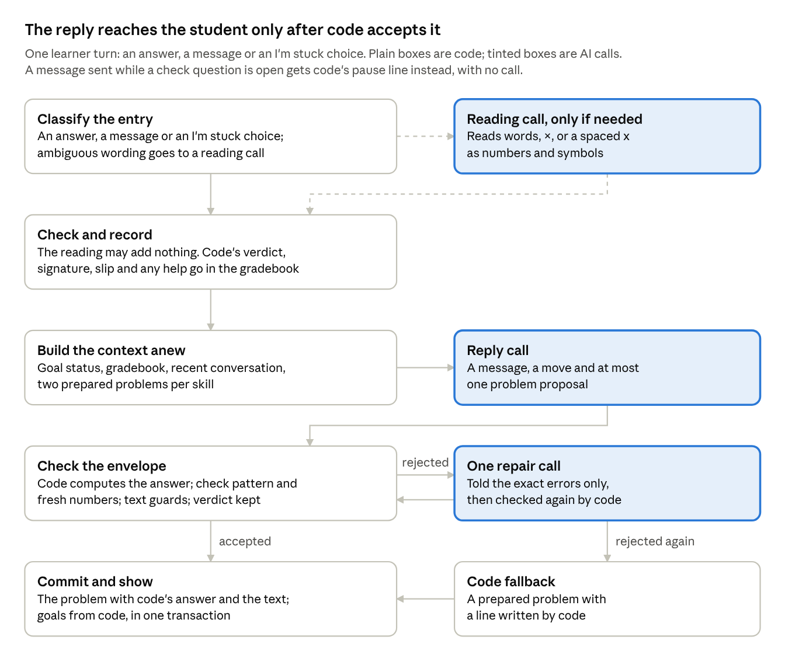

# Round 6 Stage 1 report — Algebra Engine AI tutor

2026-10-23 · branch `round6-ai-tutor`

Stage 1 is complete: the three milestones, the owner's four cases and the 11 cheating tests pass on PHP 8.0.30 and 8.3.6, and the side-by-side bundle is built but not deployed. Every result comes from the mock tutor, so nothing here shows how a live model behaves, how fast it is, or whether students learn. Instructions: `CONDUCTOR_ROUND_6_v3.md`; log: `BUILD_LOG.md`, section "Round 6".

## Branch and tag

Branch `round6-ai-tutor` is pushed with five commits; the tag `beta-1.0` exists only locally, because the session's git proxy refused tag pushes. No `claude/` prefix was needed for the branch.

| Commit | Content |
| --- | --- |
| `534cf9f` | §0: conductor file saved at the root, `CLAUDE.md` rewritten for the AI-tutor design, `CLAUDE.md` and architecture v1.3 added to the manifest check's ruled differences (`MANIFEST.sha256` untouched), Round 6 interval opened in `BUILD_LOG.md` |
| `f4548ec` | M1: the instruments |
| `0501be9` | M2: the tutor loop; the state machine and its tests retired |
| `d71c1f2` | M3: the conversation UI |
| `38dc479` | Side-by-side bundle, docs, gates on PHP 8.0.30 and 8.3.6 |

The tag `beta-1.0` is annotated on `061239c` with "Deployed at tools.constraintlayer.ai/educational-engines/algebra-engine/" and the beta VPS bundle sha256 `a1f02a0f47643e2c71e9549bd26a331a0ce79dd94815764d1c7bb1d6158efb6e`. Its push was refused three times (HTTP 403, then a dropped connection). The owner needs to run `git push origin beta-1.0`, or recreate it from a clone of `061239c`. Nothing was committed to `claude/elegant-volta-blu3uj`.

## Built, by milestone

All three milestones were committed with their tests passing; the owner's four cases and the 11 cheating tests pass, and 87% of mock turns use exactly one AI call.

### M1: the instruments (`app/private/src/Tutor/`)

- **SpecMath:** four spec kinds (`linear_equation`, `expand`, `signed_arithmetic`, `numeric_step`). Code computes every answer; a spec with no unique solution, out-of-range numbers or nothing to do fails closed.
- **PatternMatcher:** the 14 recipes used in reverse. A spec's structure gives the recipe's parameters, and the recipe's own `validate()` decides.
- **ProblemVerifier:** the stated answer must equal code's. A check question must match a pattern of its skill, must not repeat a problem or a number set already used in the session, and gets code's wording. Choice check questions come only from the contrast recipes. Practice wording must show the spec's numbers and not its answer.
- **Recipes:** two fresh problems per relevant skill before each call; for Q07 and E06, the kinds of question the goal still needs.
- **EntryReader and ReadingCheck:** safe normalisation (a capital letter as the variable, a trailing "?"); entries with words, "×" or a spaced "x" go to the AI; its reading may use only numbers and variables the student wrote.
- **AnswerCheck and SlipCheck:** the verdict, the recipe's error signatures, and a slip only on a recipe's slip signature (structure right, one calculation wrong), with its micro-step.
- **Gradebook and Goals:** every attempt with problem, skill, practice or check, entry, reading note, verdict and help; goals computed from it alone.
- **TextGuard:** answer leaks, internal vocabulary, mastery and goal claims, claims about help, contradicting code's verdict, and the check-card rule.

### M2: the tutor loop

- **TutorEngine:** one learner turn per request. Leases, idempotency and revision checks are kept from the beta. Help and answers are recorded before any AI call.
- **TutorCoordinator:** the binding call, one call per turn, the envelope checks, then one repair and a code fallback.
- **TutorPrompt:** five messages, built anew each turn: architecture, rules, the binding exchange, one JSON context block. No example responses (§7).
- **ReasoningPolicy:** thinking chosen per call (§3.6) and logged with each call's purpose; migration 005 adds those columns.
- **MockTutor:** a scripted policy plus adversarial faults.
- **TutorReport:** code writes the report from the gradebook, including the audit list.

### M3: the conversation UI

- Tutor and student messages, newest at the bottom: their own scroll box on wide screens; the page scrolls on phones, with the composer stuck to the bottom.
- The open problem is pinned above one input, with Send, "I'm stuck" (hint, explain, not learned yet) and Skip.
- Check questions are a distinct card labelled "Check question: on your own", in the conversation and pinned. A message sent while one is open gets code's pause line and no AI call.
- Code's result blocks, goal dots from code's goal status, and a wrap-up card with "Finish and see my summary".
- Kept: progress codes, the report and its download, the privacy notice, the mock badge and the mobile layout.

### The owner's four live cases (`OwnerCasesTest`)

| Case | Result |
| --- | --- |
| `9X + 8` on 9(x + 8) | Read as 9x + 8, wrong; the distribution-to-x-only signature reaches the AI |
| `16 because it's 4 x 4` | The AI reads 16 (a reading call first); code marks it correct |
| `4 x x` in a how-many-x context | Read as 4x; correct |
| `7x + 25` on 7(x + 5) | Slip confirmed by code; micro-question "Wait, what is 7 × 5?" checked by code; retry offered; the run is paused, not reset |

### Cheating tests (`CheatingTest`, 12 tests)

Each is rejected or recorded correctly: the AI marks a goal; overrules a verdict; poses a problem with a wrong answer; poses an off-pattern check problem; a reading adds numbers; a slip is claimed that the structure contradicts; the text before a check card contains its numbers; text leaks an answer; text claims mastery (or uses internal terms); a free-text message is sent during an open check problem; "without help" is recorded after a stuck entry. The twelfth test: the AI poses a problem while a check question is open.

### Calls per turn (§9.5)

Twelve scripted mock sessions (5 B1, 3 descent, 2 B11, 2 N1): 121 of 139 turns (87%) used exactly one call. Sixteen used two: the first turn of each session adds the binding call, and an entry the AI must read adds a reading call. Two used none, because a message during an open check was paused. No HOLDs and no rejected outputs occurred. Transcripts: `test-results/mock-sessions/`.

### Side-by-side bundle (§11)

`dist/algebra-engine-ai-vps-upload.zip`, 674 files, sha256 `599b68b281b846f73acf098aa3049fae5384d9611dbf0ee2dcd31adc80a337c7`, built in the PHP 8.0.30 gate. Public folder `algebra-engine-ai/` (only `index.html`, `api.php`, `assets/`) goes to `/var/www/html/educational-engines/algebra-engine-ai/`; `algebra-engine-ai-private/` goes to `/var/www/algebra-engine-ai-private/`. It has its own database and cookie path `/educational-engines/algebra-engine-ai/`, no `config.php` and nothing in `var/`. The beta's two zips in `dist/` are unchanged. **Not deployed.**

## One learner turn

Code does everything it can deterministically before the AI call and checks everything the AI returns after it; most turns are one reply call.

The AI never states a verdict and never marks a goal: code records the verdict before the call, and the commit computes goals from the gradebook. A second failed check ends in code's fallback, never in AI text the checks rejected.

## Reused and retired

The beta's checking, storage and security parts were kept as instruments; its state machine, its contracts and 79 tests that asserted its sequencing were retired. Each retired test has a one-line reason and its replacement in `app/tests/RETIRED_TESTS.md`.

**Reused:** the 14 recipes and their error signatures (`Items\Templates\*`), the math parsers and exact checkers, the answer-leak guard, storage, transactions, idempotency, provider-in-flight leases, CSRF and cookie rules, progress codes, and the downloadable report.

**Retired code:** `Workflow/*` (engine, transition guard, entry interpreter, projection), the Socratic planner, the acceptance gate, structural features, the old model coordinator, prompt assembler and mock provider, the report builder and the criteria calculator, with their contracts (model envelope, item, public view, workflow policy and others). `live_smoke.php` and `live_sessions.php` are replaced by `tools/tutor_sessions.php`. Not rebuilt: the operator correction tool and the Bluehost bundle.

| Retired tests | Count | Why | Replaced by |
| --- | --- | --- | --- |
| `BetaJourneyTest` | 11 | Asserted target → probe → descent → guided → independent → return | `TutorLoopTest`: journey (FLOW-01), deeper step back (FLOW-02), easier answer is no slip (FLOW-04), random learners, every skill starts and scores |
| `FlowTest` | 8 | Old episodes, probes and repair budget | `TutorLoopTest` (ENTRY-01, FLOW-01 to 04), `CurriculumPathsTest` (FLOW-05), `HostTest` (FLOW-07); FLOW-06 retired |
| `EvidenceTest` | 6 | Old evidence ledger and criteria | `TutorLoopTest` (EVID-01, 02), `ReportTest` (EVID-03, 04, 06); EVID-05 retired |
| `BetaGuardsTest` | 10 | Old acceptance gate and repair path | `CheatingTest`, `TutorLoopTest`, `EngineUnitsTest` |
| `IndependentEvidenceTest` | 4 | "Host line only" before an independent item; §5.2 now allows guarded tutor text before a check card | `CheatingTest`, `ReportTest` (audit list) |
| `StuckEntryTest`, `ProbeAfterHelpTest`, `MessyLearnerTest` | 14 | Guided repair, fixed lines and probe sequencing | `CheatingTest` (stuck entry), `OwnerCasesTest`, `MathScenarioTest`, `LearnerInstrumentsTest` |
| `UiRoundTest` | 7 | Guided labels and old goal lines | Browser tests, `ReportTest` |
| `SummaryWordingTest`, `ReportDownloadTest` | 8 | Old report builder | `ReportTest` (same behaviours) |
| `UpgradeTest` | 2 | No in-place upgrade: a separate install with its own database | `HostTest::testMigrationsAreSafeToRunTwice` |
| Unit: `EngineUnitsTest`, `TemplatesTest` | 9 | Transition guard, criteria calculator, guided plans | `EngineUnitsTest` (code lines, prompt shape), `ProblemInstrumentsTest` |

In the acceptance map, FLOW-06 (repair-cycle budget) and EVID-05 (correction cascade) are marked RETIRED with their reasons; the other required scenarios are implemented.

## Test results

Every gate step passed on both PHP versions, with the same results; the committed zip comes from the PHP 8.0.30 run.

| Check | PHP 8.3.6 (04:35:12–04:35:42 UTC) | PHP 8.0.30, native (04:36:03–04:36:33 UTC) |
| --- | --- | --- |
| Manifest check (before and after preflight) | Only ruled differences | Only ruled differences |
| Handoff preflight, curriculum validator and guards | Pass | Pass |
| App preflight | Pass | Pass |
| PHPUnit unit + integration | 222 pass (27,104 assertions) | 222 pass (27,104 assertions) |
| Mock tutor sessions (calls per turn) | 87% one call, 0 HOLDs | Same |
| Browser tests at 360, 390 and 1280 wide | 10/10 | 10/10 |
| Bundle build and smoke test (deploy layout) | Pass | Pass |
| Key-leak scan (428 tracked files, 2,024 entries in three zips) | 0 hits | 0 hits |

The browser checks: the conversation journey (step back, check card, pause, help, wrap-up, summary) and the slip pause, each at 390 and 1280 wide; UI-01 (keyboard, screen-reader status, no lost answers) at 360; UI-02 (safe rendering); UI-03 (skill map); UI-06 (contrast, light and dark); UI-07 (progress code, welcome back, take-over, downloaded report) at 390 and 1280. Results: `test-results/gate-php83/`, `test-results/gate-php80/`; screenshots in `test-results/browser/`.

The new browser tests found two defects, both fixed in code with a test:

1. A "product slip" was confirmed for a factor of 1 (4x + 5 on 4(x + 1)); its micro-question "4 × 1" would show its own answer. A factor of 1 is no longer a slip.
2. During a slip pause, the goal dots followed the micro-question's skill instead of the paused goal. They now stay on the paused goal.

## Conflicts with the conductor

Four points differ from the conductor's wording; each needs a ruling or an acknowledgement. Below them are the choices I made where the conductor was silent.

| Topic | Conductor | Built | Why |
| --- | --- | --- | --- |
| First turn | One call per turn (§3) | Two calls on a session's first turn: the binding call, then the reply; one call on every later turn | The binding handshake is how v1.3 is activated (HOST-13); it is not a learner turn |
| Envelope | JSON envelope (§3) | The rounds 3–5 envelope, adapted: `item` is a problem proposal, `proposed_transition` carries the AI's move, a `reading` field is added; `architecture_version` 1.3 | Keeps the schema checks, binding and repair machinery, and the report schema |
| Audit list | Forward-looking phrases go on an audit list in the report (§5.2) | The report lists the phrases and the check question they came before; the AI's full text stays only in the session log | UI v3 allows no AI-written text in the report |
| Lease | — (beta: 90 s) | 150 s | A reading call, a reply and one repair at a 45 s timeout must fit inside the lease |

**Choices where the conductor was silent:**

- **Fresh numbers:** a check question may not reuse a number set already used for that skill in the session. Without this the mock reused 7(x + 11) right after the student expanded it, so the check did not stand alone.
- **Typed stuck phrases** ("idk", "help", "???") count as "I'm stuck" with a hint, so the next answer is with help.
- **Report columns:** practice, retry and after-help attempts are counted under "with help or practice".
- **Reasoning default:** `per_call` applies when nothing is configured (mock mode). A live config must name the setting explicitly, or preflight fails.
- **E06 signature name:** on E06 the distribution-to-x-only error is recorded as `FIRST_TERM_ONLY` (the factor multiplied only the x); on Q07 it is `DIST_X_ONLY`. Both reach the AI as the same observation.
- **Moves:** the AI may move only among the ten skills in this tutor; a move to A07 or any other skill is rejected and the focus is unchanged.
- **Bundle:** round 6 builds only the side-by-side VPS bundle; the beta's Bluehost and VPS zips stay unchanged in `dist/`.

## Decisions needed

Five rulings are open; the first two block Stage 2, the rest can be ruled with it.

- [ ] **Tag (owner):** push `beta-1.0`, or allow tag pushes from this environment.
- [ ] **Stage 2 inputs (owner):** a temporary key, and confirmation of the base URL and the two models (`deepseek-flash`, `deepseek-v4-pro`) for runs (a) to (d) in §10.
- [ ] **Reading check (architect):** code rejects a reading that adds numbers or letters, but a reading that drops part of the entry passes. The mock once read "2 x x + 2" as "2x" and code marked a correct answer wrong. Should code also require the reading to keep every number and variable term the student wrote, outside words?
- [ ] **First turn (architect):** accept two calls on a session's first turn (binding, then reply), or fold the binding into the first reply.
- [ ] **Audit list form (architect):** confirm that listing the phrases and the check question, without the AI's text, satisfies §5.2 under the UI v3 rule.

## Where to look

All paths are on branch `round6-ai-tutor` of `christopherfi-dev/noon`.

| Path | What it holds |
| --- | --- |
| `CONDUCTOR_ROUND_6_v3.md`, `CLAUDE.md` | The instructions, and the rewritten build instructions for this design |
| `architecture/Algebra_Constraint_Architecture_v1.3.md` | v1.3 (no example responses); changes in `architecture/CHANGELOG.md` |
| `app/private/src/Tutor/` | The instruments, the tutor loop and the mock tutor |
| `app/private/resources/contracts/tutor-*.schema.json` | Envelope, event, view and session contracts |
| `app/tests/Integration/OwnerCasesTest.php`, `CheatingTest.php`, `TutorLoopTest.php` | The owner's cases, the cheating tests, the loop |
| `app/tests/RETIRED_TESTS.md` | Every retired test, with its reason and replacement |
| `app/tools/tutor_sessions.php` | Scripted sessions: mock now, the Stage 2 runner with a live config |
| `test-results/gate-php80/`, `gate-php83/`, `mock-sessions/`, `browser/` | Gate outputs, calls-per-turn transcripts and screenshots |
| `dist/algebra-engine-ai-vps-upload.zip`; `app/DEPLOYMENT_VPS.md` | The bundle, and how to install it beside the beta |
| `BUILD_LOG.md`, section "Round 6" | Timed log of every step |
